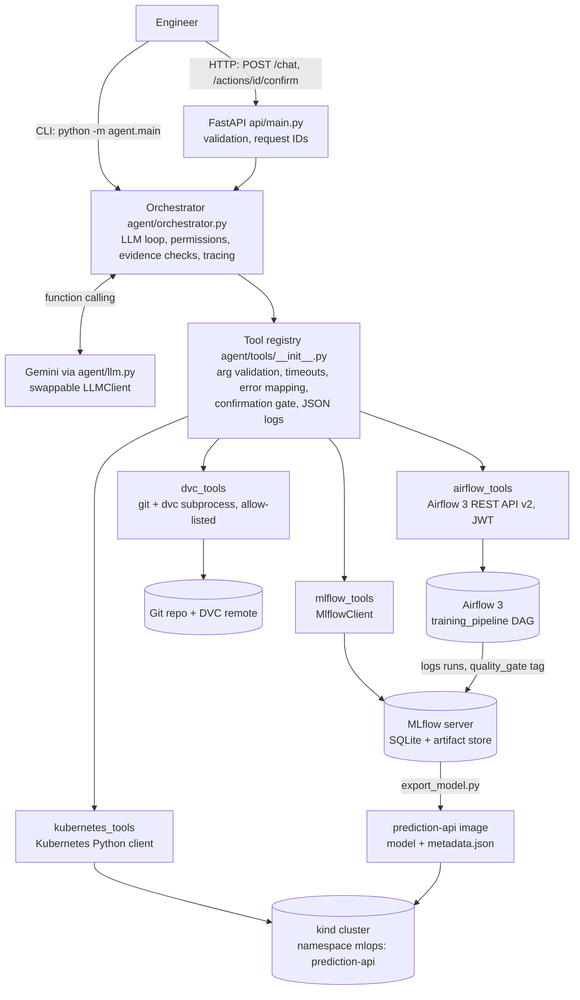

# Architecture

The MLOps agent turns natural-language requests into tool calls against DVC, MLflow, Apache
Airflow 3 and Kubernetes, and answers only with what those tools returned.

## Components



| Component | File(s) | Responsibility |
|---|---|---|
| Configuration | `agent/config.py` | Validated settings from env / `.env`, fail fast, API key as `SecretStr` |
| Logging | `agent/logging_config.py` | JSON logs with request ID, tool name, status, duration; secret redaction |
| Schemas | `agent/schemas.py` | `ToolSpec`, `ToolResult`, `ChatResponse` (facts with sources, uncertainties, actions), `PendingAction` |
| Tool registry | `agent/tools/__init__.py` | Only execution path for tools; never raises; maps failures to `unavailable`, `timeout`, `invalid_request`, `forbidden`, `confirmation_required`, `error` |
| LLM adapter | `agent/llm.py` | Provider-neutral `LLMClient`; Gemini implementation with manual function calling (automatic calling disabled) |
| Orchestrator | `agent/orchestrator.py` | System prompt with evidence/safety/retraining policy, tool loop with step and tool budgets, pending-action store, evidence guard |
| API | `api/main.py` | `/health`, `/tools`, `/chat`, `/actions`, `/actions/{id}/confirm` |
| CLI | `agent/main.py` | Interactive chat, approval prompt, `--save` to export answer + raw tool evidence |
| Training DAG | `dags/training_pipeline.py`, `training/pipeline_steps.py` | validate, preprocess, train, evaluate/log to MLflow, quality gate |
| Inference service | `serving/app.py`, `Dockerfile`, `kubernetes/*.yaml` | FastAPI prediction API; `/healthz`, `/readyz`, `/version`, `/predict` |

## Request flow

1. The request gets a request ID (from `X-Request-ID` or generated) bound to all log lines.
2. The orchestrator starts an LLM session with the system prompt and every registered `ToolSpec`.
3. For each tool call the model makes, the registry validates arguments against the schema,
   enforces confirmation and the timeout, runs the tool, and logs one structured line.
4. Results go back to the model (failed calls carry an explicit "no data" note).
5. The model answers with JSON: `answer`, `facts[{statement, sources}]`, `uncertainties`,
   `recommended_actions`.
6. **Evidence guard (in code):** a fact is kept only if every tool it cites succeeded in this
   request; otherwise it moves to `uncertainties` as *Unverified*. Every failed tool call is
   added to `uncertainties` too, so missing data is always visible.

## Provenance chain (how the four systems are correlated)

```
DVC pointer md5 ──recorded as tag──▶ MLflow run (dvc_md5, dataset_version, dataset_git_commit,
                                       git_commit, quality_gate, airflow_run_id)
MLflow run ──export_model.py──▶ serving/model/metadata.json ──baked into image──▶ Pod /version
Airflow run ──evaluate task──▶ MLflow run tag airflow_run_id; quality_gate task ──▶ tag quality_gate
```

So the agent can go from "what is deployed" (`k8s_deployed_version`) to the MLflow run, from the
run to the dataset hash, and from the hash to the DVC version and Git commit
(`dvc_find_version_by_hash`), and compare it with the current dataset (`dvc_current_version`)
and the latest pipeline run (`airflow_get_dag_runs`).

## Tools and permissions

| Tool | System | Arguments (`?` optional) | Permission |
|---|---|---|---|
| `dvc_list_datasets` | dvc | - | read-only |
| `dvc_current_version` | dvc | path? | read-only |
| `dvc_list_versions` | dvc | path?, limit? | read-only |
| `dvc_compare_versions` | dvc | from_ref, to_ref, path? | read-only |
| `dvc_check_changes` | dvc | path?, remote? | read-only |
| `dvc_reproduce_instructions` | dvc | version, path? | read-only |
| `dvc_find_version_by_hash` | dvc | md5, path? | read-only |
| `mlflow_list_experiments` | mlflow | - | read-only |
| `mlflow_list_runs` | mlflow | experiment_name, limit? | read-only |
| `mlflow_get_run` | mlflow | run_id?, run_name?, experiment_name? | read-only |
| `mlflow_best_run` | mlflow | experiment_name, metric?, mode?, dataset_version? | read-only |
| `mlflow_compare_runs` | mlflow | experiment_name, last_n?, run_ids?, metric? | read-only |
| `mlflow_compare_experiments` | mlflow | experiment_names, metric? | read-only |
| `mlflow_registry_info` | mlflow | model_name? | read-only |
| `airflow_list_dags` | airflow | - | read-only |
| `airflow_get_dag_runs` | airflow | dag_id, limit? | read-only |
| `airflow_get_run_details` | airflow | dag_id, dag_run_id? | read-only |
| `airflow_wait_for_run` | airflow | dag_id, dag_run_id, timeout_seconds? | read-only |
| `airflow_trigger_dag` | airflow | dag_id, min_f1?, n_estimators?, max_depth? | **writes, needs approval** |
| `airflow_failed_tasks` | airflow | dag_id, dag_run_id? | read-only |
| `airflow_task_logs` | airflow | dag_id, dag_run_id, task_id, try_number?, tail? | read-only |
| `k8s_list_deployments` | kubernetes | namespace? | read-only |
| `k8s_list_pods` | kubernetes | namespace?, label_selector? | read-only |
| `k8s_pod_logs` | kubernetes | pod_name, namespace?, tail?, previous? | read-only |
| `k8s_list_services` | kubernetes | namespace? | read-only |
| `k8s_get_events` | kubernetes | namespace?, warnings_only?, object_name?, limit? | read-only |
| `k8s_unhealthy_pods` | kubernetes | namespace? | read-only |
| `k8s_deployed_version` | kubernetes | namespace?, deployment?, service? | read-only |
| `k8s_diagnose_service` | kubernetes | namespace?, deployment?, service? | read-only |
| `k8s_restart_deployment` | kubernetes | deployment, namespace? | **writes, needs approval** |
| `k8s_scale_deployment` | kubernetes | deployment, replicas, namespace? | **writes, needs approval** |

## Safety controls

| Control | Where it is enforced |
|---|---|
| State-changing tools never run inside a chat turn; they become single-use, expiring `PendingAction`s that only the user can approve | registry (`requires_confirmation`) + orchestrator + `/actions/{id}/confirm` |
| The LLM cannot approve anything: the tool loop always executes with `confirmed=False` | `Orchestrator._execute` |
| Kubernetes: every tool is limited to `K8S_ALLOWED_NAMESPACES` (default `mlops`); no delete/exec/secret tools; scale bounded to 1-5 | `kubernetes_tools._namespace`, tool set |
| Kubernetes RBAC: optional `mlops-agent` ServiceAccount with a namespaced Role (read + patch deployments only) | `kubernetes/agent-rbac.yaml`, `scripts/agent_kubeconfig.sh` |
| Airflow: only allow-listed DAGs can be triggered; `conf` values are range-checked; IDs are regex-validated and URL-encoded | `airflow_tools` |
| DVC/Git: only allow-listed subcommands, no shell, validated refs and paths | `dvc_tools._run`, `_validate_ref` |
| MLflow: names and metrics validated before building search filters | `mlflow_tools` |
| Retraining is never automatic; the prompt requires evidence (age policy, failed gate, supplied degradation, newer data) | system prompt + confirmation gate |
| Secrets only from environment; redacted in logs, tool errors and log tails | `config.py`, `logging_config.redact` |
| Budgets: max LLM steps and max tool calls per request; per-tool timeouts | orchestrator, registry |

## Training pipeline (Airflow 3)

`validate_dataset → preprocess_data → train_model → evaluate_and_log_mlflow → quality_gate`

- Each task runs `training/pipeline_steps.py <stage>` with the project's Python and prints one
  JSON line; non-zero exit fails the task.
- Validation checks the DVC hash, schema, row count, nulls and class balance; failure stops the
  run (`retries=0`, deterministic). Training/evaluation retry twice (infrastructure-prone).
- The quality gate tags the MLflow run `quality_gate=passed|failed` and fails the task below
  `min_f1`, so no downstream promotion can run after a failed gate.

## Kubernetes deployment

Namespace `mlops`: ConfigMap (non-sensitive config), Deployment `prediction-api` (2 replicas,
rolling update with `maxUnavailable: 0`, readiness `/readyz`, liveness `/healthz`, CPU/memory
requests and limits, non-root, read-only root FS), ClusterIP Service on port 80. If the model
fails to load the Pod stays alive but is not Ready, so it receives no traffic.
